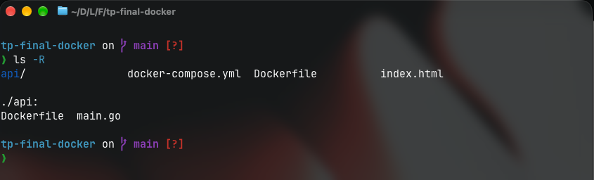
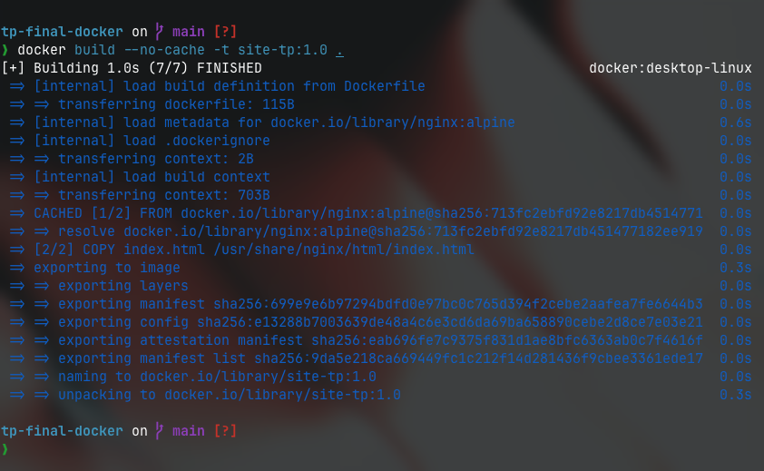
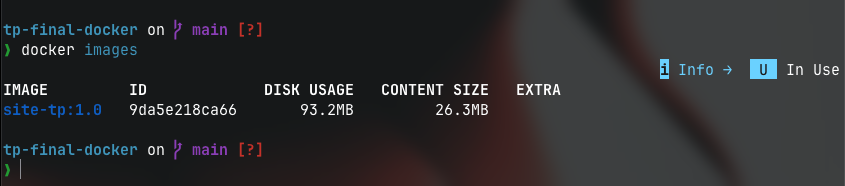
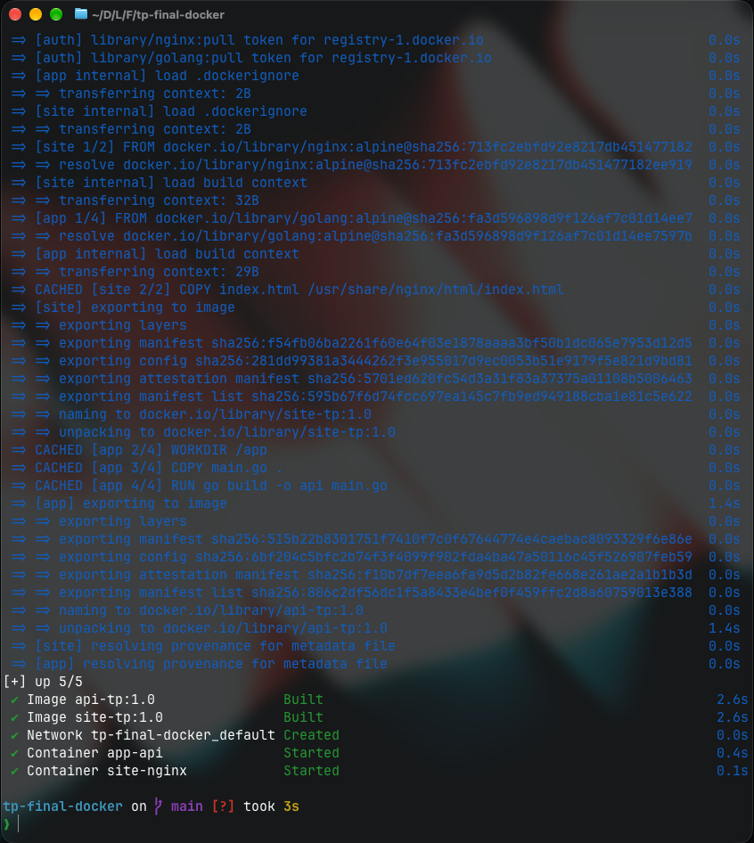
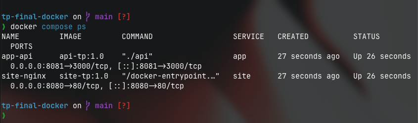
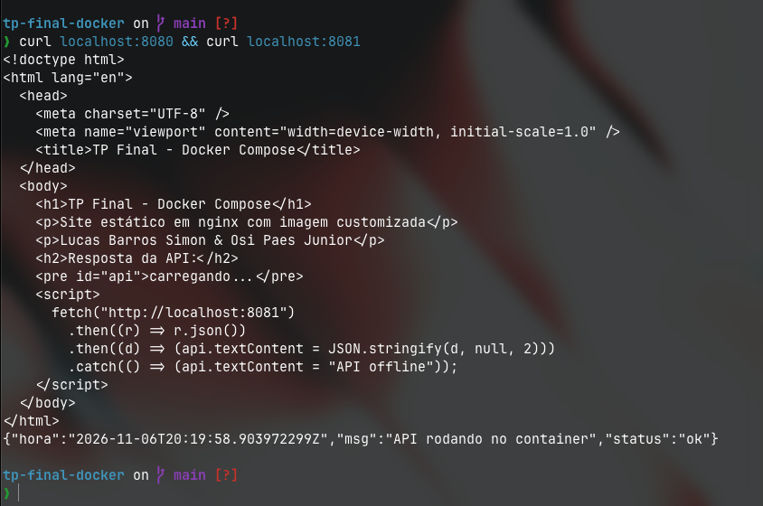
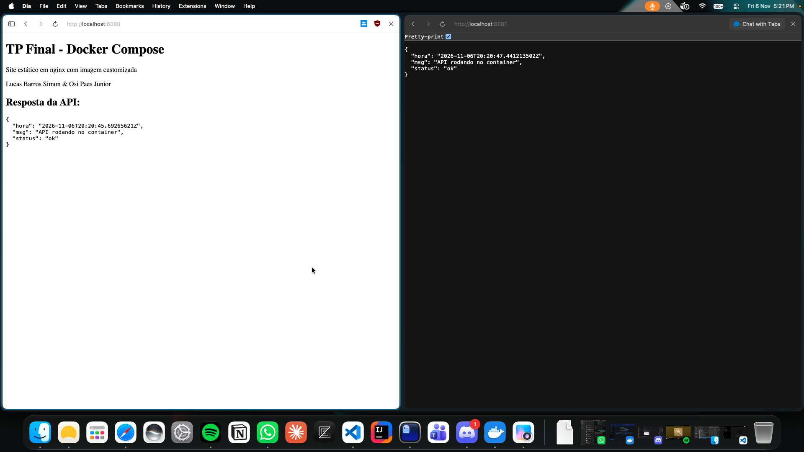
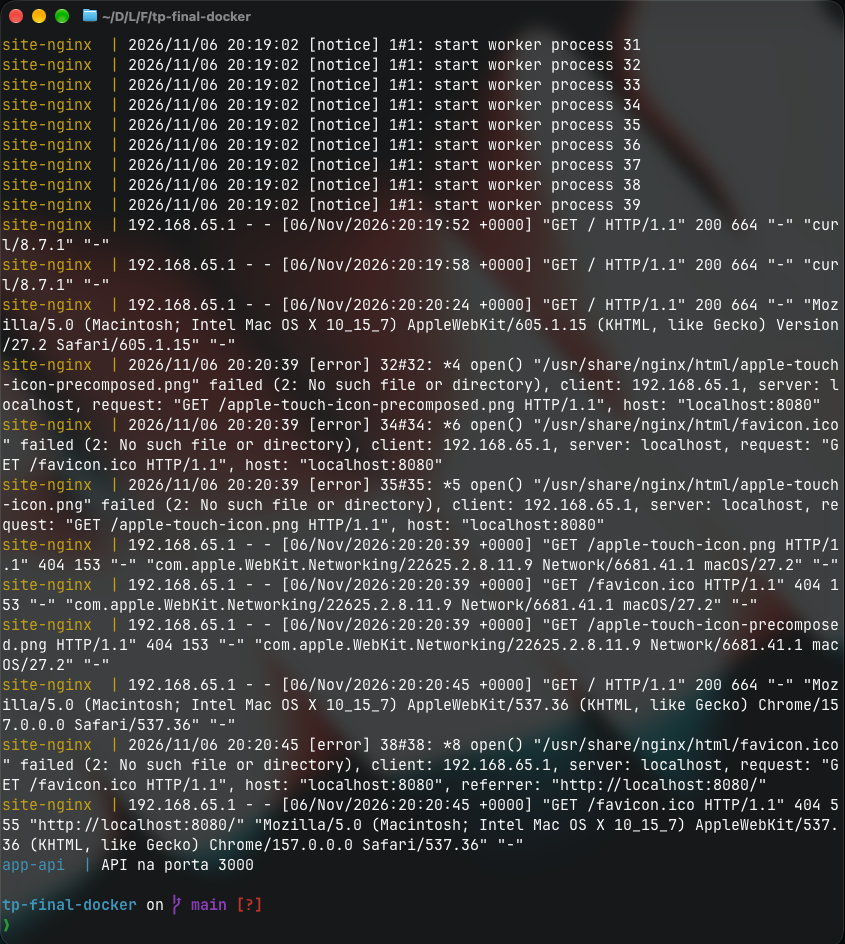
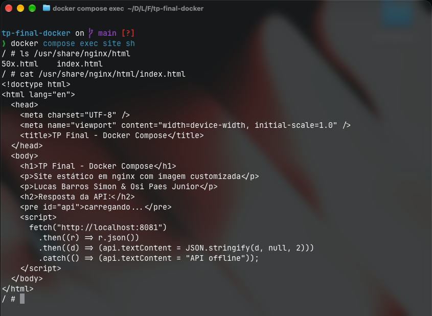
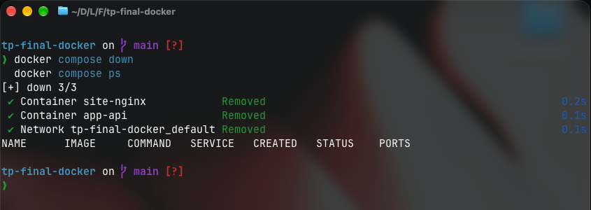

# TP Final - Docker Compose

TP final da matéria de Arquitetura de Serviços em Nuvem (prof. Andrews Egas).

**Alunos:**
- Lucas Barros Simon - RA 235182
- Osi Paes Junior - RA 237112

## Sobre o trabalho

O objetivo era subir dois containers juntos usando docker compose. A gente fez assim:

- **site**: um html estático rodando no nginx, com imagem customizada (porta 8080)
- **api**: uma api simples em Go que devolve um json (porta 8081)

O site faz um fetch na api e mostra a resposta na tela.

## Por que Go?

Basicamente porque eu (Lucas) tô querendo aprender Go faz um tempo e ainda não tinha feito nada com a linguagem. Como a api do TP era bem simples, achei que era uma boa oportunidade de juntar as duas coisas, estudar docker pra matéria e já ir praticando Go.

E acabou sendo tranquilo, porque o Go já vem com o pacote `net/http` então não precisou instalar nenhum framework nem nada, ficou tudo num arquivo só (`api/main.go`). No Dockerfile é só dar `go build` e rodar o binário que ele gera.

## Estrutura

```
tp-final-docker/
├── api/
│   ├── Dockerfile
│   └── main.go
├── docs/              (prints)
├── Dockerfile         (imagem do site)
├── docker-compose.yml
└── index.html
```

## Como rodar

Precisa ter o docker instalado.

```bash
docker compose up -d --build
```

Depois é só acessar:
- site: http://localhost:8080
- api: http://localhost:8081

Pra derrubar:

```bash
docker compose down
```

## Passo a passo (prints)

### 1. Estrutura do projeto

`ls -R` pra mostrar os arquivos. Na raiz ficam o index.html, o Dockerfile e o docker-compose.yml, e na pasta api/ fica o main.go e o Dockerfile da api.



### 2. Build da imagem customizada

`docker build --no-cache -t site-tp:1.0 .`

Gera a imagem do site usando o `nginx:alpine` como base e copiando o index.html pra dentro.



Com `docker images` dá pra ver que a imagem site-tp:1.0 foi criada:



### 3. Subindo com docker compose

`docker compose up -d --build`

Builda as duas imagens, cria a rede e sobe os containers `app-api` e `site-nginx`.



`docker compose ps` mostrando os dois containers rodando (Up) nas portas 8080 e 8081:



### 4. Testes

`curl localhost:8080 && curl localhost:8081`

O primeiro devolve o html do site e o segundo o json da api.



No navegador, o localhost:8080 mostra o site já com a resposta da api, e o localhost:8081 mostra o json:



### 5. Comandos extras

`docker compose logs` mostra os acessos no nginx e a mensagem "API na porta 3000" da api. (os erros de favicon que aparecem é só porque o navegador tenta pegar o ícone e a gente não colocou nenhum)



`docker compose exec site sh` pra entrar dentro do container do site. Dá pra ver que o index.html foi copiado pra /usr/share/nginx/html:



### 6. Finalização

`docker compose down` e depois `docker compose ps` pra confirmar que os containers e a rede foram removidos (a lista fica vazia).



## Obs

- O fetch do site usa `localhost:8081` e não o nome do serviço (`app`) porque o javascript roda no navegador, fora do docker, então ele não conhece esse nome.
- Precisou colocar o header `Access-Control-Allow-Origin` na api por causa do CORS, já que o site e a api estão em portas diferentes.
